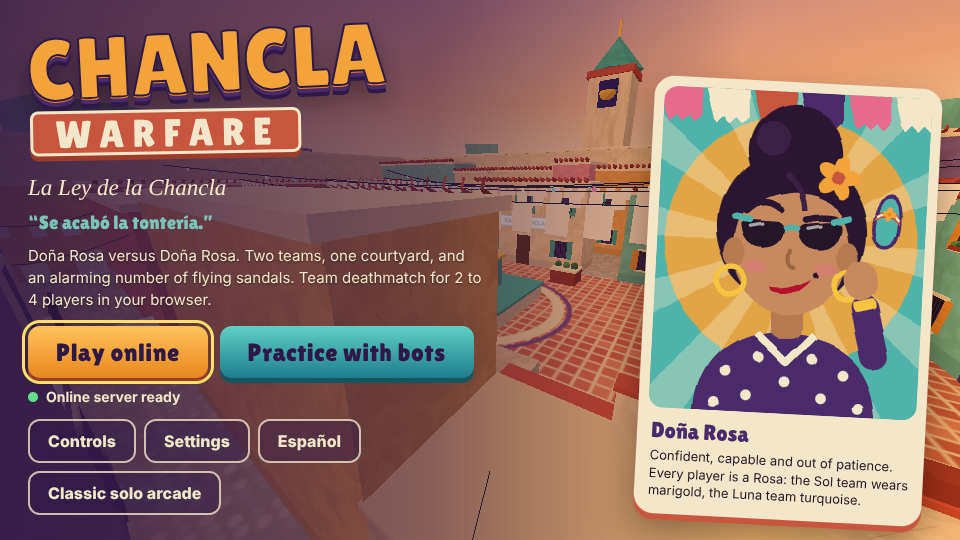

# CHANCLA WARFARE: La Ley de la Chancla

> “Se acabó la tontería.”



Doña Rosa versus Doña Rosa. A comedic first-person team shooter for the browser: two teams of Rosas, one sunlit courtyard called **El Patio**, and two kinds of flying footwear.

- **Online:** private rooms for 2 to 4 players, 2v2 team deathmatch, joined with a shareable invite link.
- **Practice:** offline against clearly labeled bots, in the same simulation as online.
- **Languages:** English and Spanish throughout.
- **Classic solo arcade:** the original wave-and-boss game is still at [`/classic.html`](docs/CLASSIC.md).

**Site:** https://chancla.vercel.app. The site deploys from `main`. Online play also needs the game server, which is not hosted anywhere yet; see [Deploying](#deploying). Until it is, the deployed site offers practice only and says so on the title screen.

## Playing with two friends

1. One person opens the site, picks **Play online → Create private room**, and clicks **Copy invite link**.
2. They send the link (it looks like `https://chancla.vercel.app/#room=ABCD2345`). The 8-character code is the only key to the room, so share it only with the people you want in.
3. Friends open the link, type a name and press **Join**. Teams fill automatically, and anyone can press **Switch team**.
4. Everyone except the host presses **I'm ready**, then the host presses **Start match**. A 2-player match (1v1) is allowed. The host can fill empty seats with bots, which are labeled **BOT** everywhere.
5. Match: 5 minutes, first team to 25 eliminations, respawn after 3 s, no friendly fire. Spawn protection lasts 2 s and ends as soon as you throw. If time runs out with equal scores, it is a tie.
6. Results: the host picks **Rematch** (same teams, straight back in) or **Back to lobby**.

## Controls

| Action | Keys |
| --- | --- |
| Move | W A S D or arrow keys |
| Look | Mouse or trackpad (click the game to lock the pointer) |
| Throw | Left click, or F (also E) |
| Jump / crouch | Space / C or Shift |
| Switch chancla | 1, 2, Q, mouse wheel or right click |
| Scoreboard | Hold Tab |
| Menu | Esc |

**Trackpad:** F throws, so your fingers can stay on the pad, and two-finger scroll switches weapons at most once per gesture. If the browser refuses pointer lock, the game switches to drag-to-look automatically. Ctrl, Cmd and Alt shortcuts are never captured, so Ctrl+W and Cmd+Q behave normally. That is why crouch is C or Shift, not Ctrl.

**Weapons:** La Chancla is fast and accurate. It lands where the crosshair points, bounces once off walls, and recovers in 0.42 s. La Pesada is a slow, arcing clog: 62 damage plus 26 splash around corners and big knockback, but a 1.15 s recovery and no bounce. A bot or player in the open is easier to tag with the chancla; someone camping behind cover is a job for La Pesada.

**Settings** (saved per browser): language, mouse sensitivity, invert Y, field of view, reduced motion, graphics quality, music and effects volume, and an FPS/ping readout.

Phones and tablets can open the menus, but touch combat is not supported in this release. The title screen says so on touch devices.

## Running it locally

Requires Node 22.

```bash
npm ci
npm run dev:server      # game server on ws://localhost:8787/ws (restarts on change)
npm run dev             # site on http://localhost:5173 (it finds the local server automatically)
```

Open http://localhost:5173 in two browser windows (one of them private, so each gets its own player) and use the invite link from one in the other.

Other commands:

```bash
npm run build           # type-check and build the site into dist/
npm run build:server    # bundle the server into dist-server/
npm run start:server    # run the bundled server
npm test                # all unit, simulation and real-server multiplayer tests
node --import tsx scripts/mp-e2e.ts 2    # browser e2e, 2 players (after npm run build)
node --import tsx scripts/mp-e2e.ts 4    # browser e2e, 4 players
node --import tsx scripts/bench-server.ts  # server CPU cost per room
```

## How it works

```
shared/                 runs on the server AND in the browser
  config.ts             every balance value: match rules, movement, weapons, bots, network rates
  map.ts                El Patio: collision boxes, spawns, regions, waypoints, pickups
  physics.ts            deterministic movement: swept boxes, step-up, crouch headroom, grid broadphase
  collision.ts          swept segment vs box, capsule and sphere; line of sight
  sim.ts                MatchSim: inputs, projectiles, ricochet, splash, damage, scoring, respawn, end
  bots.ts, navgraph.ts  bot brains on a waypoint graph built by simulating walks
  protocol.ts           message types and strict validation of everything a client sends
  room.ts, hub.ts       rooms, teams, lobby and match lifecycle, reconnection, owner transfer
server/index.ts         WebSocket server: origin checks, rate and size limits, health, shutdown
src/net/session.ts      client prediction, reconciliation, interpolation, reconnect
src/net/local.ts        practice: the real Hub and Room running inside the page
src/fps/                engine (three.js), HUD, input, menus and the UI state machine, EN/ES strings
src/fps/render/         El Patio visuals, Rosa avatars and animations, first-person hand, projectiles
```

**Server authority.** The server owns membership, teams, the match lifecycle, movement, health, projectiles, cooldowns, respawns, scores and results. Clients send only their inputs (move axes, look angles, buttons, weapon) with sequence numbers, at 60 Hz. The server simulates at 60 Hz with the same code the client uses, refills each player's input allowance at 1.02 inputs per tick (so nobody can move faster by sending more), and sends snapshots at 20 Hz.

**Netcode.** Your own movement is predicted immediately and reconciled by replaying unacknowledged inputs. Small corrections are blended out over about 100 ms. Other players are interpolated 110 ms in the past. Your own throws show instantly as cosmetic predictions, but damage, hit markers and eliminations appear only when the server confirms them. Projectiles are swept every tick against capsules and walls, so they cannot tunnel. There is no lag compensation: at high ping you lead your targets slightly. This trade keeps the server simple and makes "shot around a corner" complaints impossible.

**Practice** runs the real room code inside the page, behind the same message interface the server uses, with a clock that stops while the menu is open.

**Abuse limits.** Every message is schema-validated and size-capped (4 KB). Inputs and control messages are rate-limited per connection, connections are capped per IP, and rooms are capped per server. Names are sanitized. Only listed origins can connect. Room codes are 8 random characters from a 31-symbol alphabet and are never written to logs. None of this makes the game cheat-proof: a modified client can still aim for you. It prevents speed, cooldown and damage cheats, because the server decides those.

## Verification

What was actually run, in this Linux container (Node 22, headless Chromium with SwiftShader software rendering, no GPU, 4 vCPUs). See [docs/COMPATIBILITY.md](docs/COMPATIBILITY.md) for what this does and does not cover.

- `npm test`: unit and simulation tests plus real-server multiplayer tests. They cover movement and collision (stairs, ceilings, crouch), map rules (spawn protection, no spawn-to-spawn sightlines), weapons, ricochet, splash, friendly fire off, spawn protection cancelled by attacking, score and time endings including ties, respawn, pickups, bots navigating and fighting under the same rules, room flows (full and invalid rooms, duplicate tabs, reconnection within the grace period, owner transfer, version mismatch), a 4-client match through results and rematch, and a **150 ms RTT jitter relay with a forced connection drop**.
- **Browser end to end** (`scripts/mp-e2e.ts`): separate browser contexts play through the real UI: create, join by invite link, ready-gating, start, a full match, identical results on every client, host-only rematch, leaving mid-match with confirmation, and an invalid-code error. Movement and firing use the page's real keyboard and mouse handlers; aim is scripted. Both the 2-player run and the 4-player (2v2) run passed with no console errors. In the 2-player run the match ended 1-1 on time, with eliminations on both sides. In the 4-player run every client was software-rendering at a few frames per second, and nobody was eliminated before time ran out (0-0). So in the browser, the 4-player run proves the flow, not the combat. Four-client combat and scoring are covered by the Node test `tests/mp-four.test.ts`.
- **Practice and UI** (`scripts/practice-e2e.ts`): 12 checks, all passing. Bots fill a 2v2 and are labeled BOT. The practice clock freezes while the menu is open and resumes after. The Spanish toggle works. Quality changes apply live. Leaving asks for confirmation. Settings persist across reloads. There are no console errors. With 3D disabled, the title explains the problem and settings still work.
- Classic solo mode: its original 72 browser checks still pass, now at `/classic.html`.
- Evidence: screenshots and a match clip in [docs/evidence/](docs/evidence/). There is also the JSON report (`e2e-*.json`).

Measured performance: see [Performance](#performance).

What was **not** verified: real Windows or macOS machines, Safari, real GPUs, human playtesting, and listening to the audio. These are listed in [docs/COMPATIBILITY.md](docs/COMPATIBILITY.md) with a manual checklist.

## Performance

All numbers below were measured in this container. None of them come from real gaming hardware.

| What | Measured | How |
| --- | --- | --- |
| Server CPU per active room (1 player + 3 bots, live match) | about 1.3 ms per second of play (0.13% of one core) | `scripts/bench-server.ts`, output in `docs/evidence/bench-server.txt` |
| Server, 50 rooms at once | 6.7% of one core; worst single loop 5.2 ms (budget 16.7 ms) | same |
| Snapshot traffic | about 7.9 KB/s per connected player (the 20 Hz snapshots) | same; about 6.4 KB/s in the real-socket latency test |
| Prediction at 150 to 167 ms RTT with jitter | 0 corrections during normal play; one 3.5 m snap after a forced disconnect; reconnect in about 0.6 s | `tests/mp-latency.test.ts` |
| Client CPU time per frame (JavaScript, not GPU) | about 3 ms | `frameMs` from the e2e runs |
| Client frame rate | 10 to 12 fps | Headless Chromium with **SwiftShader CPU rendering** and 2 to 4 clients sharing 4 vCPUs. This measures the software rasterizer, not the game, and says nothing about a real GPU. |
| Draw calls in a match (low quality) | 22 to 25 | e2e client info |
| Site download (JavaScript, gzip) | about 105 KB before the menus show; about 210 KB in total once the 3D engine and three.js load | `npm run build`, gzip of `dist/assets` |

Frame rate on real Windows and Mac hardware is **unmeasured**. To measure it, turn on Settings → Show frame rate and ping.

## Deploying

The site stays on Vercel. The game server needs a host with long-lived WebSockets. Step-by-step instructions are in [docs/DEPLOY.md](docs/DEPLOY.md), covering:

- the Dockerfile,
- `server/.env.example`,
- a Fly.io example,
- health endpoints,
- graceful shutdown.

Nothing has been provisioned or paid for. Once a server exists, set `VITE_GAME_SERVER_URL=wss://…/ws` in Vercel and redeploy.

## Assets

Everything is generated in code: geometry, textures, animation and synthesized audio. The only third-party pieces are the Lilita One font (OFL) and the three.js and ws libraries (MIT). Full inventory: [docs/ASSETS.md](docs/ASSETS.md) and [ATTRIBUTION.md](ATTRIBUTION.md).

## Known limitations

- **One server process.** Rooms live in memory, so a restart or deploy ends running matches. Clients see a clear message and can make a new room.
- **No lag compensation.** At high ping, lead your targets.
- **Bots:** they navigate, see, chase and throw with deliberate aim error, but they are simple. They don't flank, and they don't use La Pesada splash cleverly.
- **Touch:** touch combat is not supported.
- **Not in this release:** text or voice chat, accounts, ranked play, cosmetics, more maps.
- **Unverified:** frame rates on real hardware, Safari, and real Windows and macOS machines (see Verification).
