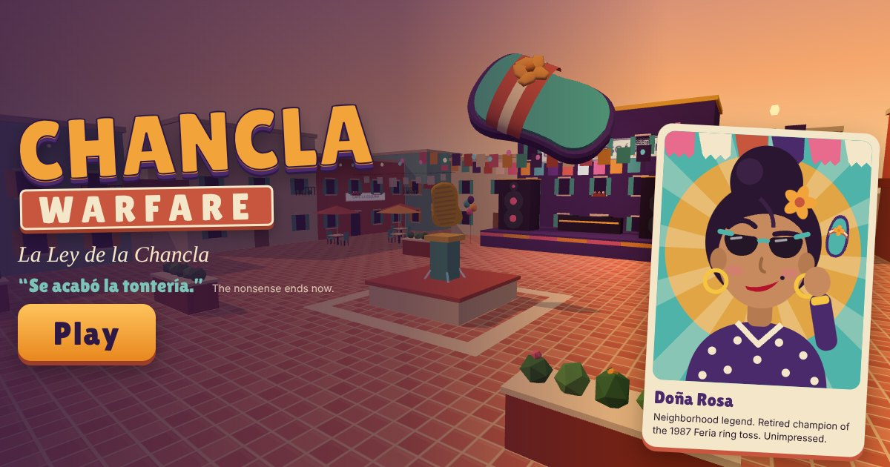

# CHANCLA WARFARE: La Ley de la Chancla

> “Se acabó la tontería.”



A comedic first-person arcade game for the browser. You are **Doña Rosa**, neighborhood legend, and your peaceful Sunday has been hijacked by loudspeakers, influencers and leaf blowers. You have two exceptionally aerodynamic chanclas and zero patience.

One golden-hour courtyard, a short interactive tutorial, three escalating waves, a boss (**EL REY DEL ESCÁNDALO** and his enormous speaker stack), results, replay. A full run takes roughly three to five minutes.

Everything runs client-side. No accounts, no API keys, no backend. All models, art, dialogue, sound effects and music are original; see [ATTRIBUTION.md](ATTRIBUTION.md).

## Controls

| Action | Desktop | Touch |
| --- | --- | --- |
| Move | WASD or arrow keys | Left virtual stick |
| Look | Mouse or trackpad (pointer lock), or drag if pointer lock is unavailable | Drag on the right half |
| Quick throw | Click or Space | Tap the big chancla button |
| Charged throw | Hold, then release | Hold the button, then release (dragging on it also aims) |
| Recall chanclas | R (or right-click) | ↩ button |
| La Chancla Legendaria | Q (when the ★ meter is full) | ★ button |
| Pause | Esc (also P) | ❚❚ button |

Mac trackpad tip: Space throws (hold to charge), so your fingers can stay on the pad. Sensitivity, invert-Y, aim assistance, reduced motion, graphics quality, volume, music and language are in Settings.

## Running it

Requires Node 22 (see `.nvmrc`).

```bash
npm ci              # install exact, locked dependencies
npm run dev         # development server with hot reload (not for hosting)
npm run build       # type-check, then production build into dist/
npm run preview     # serve dist/ locally on http://localhost:4173
npm run typecheck   # TypeScript, strict mode
npm test            # unit, integration and balance tests (Vitest)
npm run e2e         # browser checks against a running preview (see below)
```

`npm run e2e` drives the production build in headless Chromium. Start `npm run preview` in another terminal first. It looks for Chromium at `CHROMIUM_PATH` or Playwright's default location; set `E2E_URL` to test a deployed site.

`node scripts/make-assets.mjs` (with the preview running) regenerates the PNG icons and the social preview image from the game itself.

## How it works

```
src/
  main.ts            tiny entry: loading progress, WebGL check, friendly failure screens
  bootstrap.ts       creates the renderer, game and app; precompiles every shader
  app.ts             screens, settings, pause/visibility/context-loss handling, camera, viewmodel, wiring
  config.ts          all gameplay tuning in one place
  core/              fixed-timestep loop, typed emitter, tracked DOM listeners, seeded RNG, math
  game/
    game.ts          run orchestration: phases, input handling, aiming, hits, scoring hooks
    chanclas.ts      the chancla projectile system and its lifecycle
    enemies.ts       El Bocinas, El Influencer, El Soplador: state machines and animation
    boss.ts          EL REY DEL ESCÁNDALO: three-attack cycle with vulnerable windows
    hazards.ts       telegraphed cones, bass-drop rings and projectiles, blocked by cover
    waves.ts         wave definitions and the spawn director
    scoring.ts       points, combo multiplier, accuracy streak (pure, no rendering)
    player.ts, pickups.ts, tutorial.ts
  physics/collision.ts   swept segment vs box/capsule/sphere, circle movement, line of sight
  world/             arena construction, palette and shared materials, grid navigation (A*)
  models/            procedural low-poly sandal, hand and characters
  fx/                pooled instanced particles, camera-facing trails
  audio/audio.ts     Web Audio synthesis: every effect plus a small cumbia loop
  input/input.ts     keyboard, mouse, pointer lock with drag fallback
  ui/                HUD, world-space callouts, touch controls, sharing and score card, vector art
  i18n/              every interface string in English and Spanish, applied via data attributes
  persistence/       storage that never throws, settings and saved progress kept separate
```

**The chancla.** Each real chancla moves through `held → flying → returning → held`. While flying it integrates velocity and gravity at a fixed 60 Hz and tests the segment it travels each step against enemy capsules, the boss's shield sphere and every world box, taking the earliest contact, so fast throws cannot pass through walls or enemies. It damages each target at most once per throw, ricochets off at most one solid surface, and ends its flight on impact, range, time or recall. Returning chanclas ignore collisions, home in on Rosa's hand with increasing speed, and snap back after a timeout, so ammunition can never be lost. Legendaria copies are a separate pool that expires instead of returning.

**Aiming.** The throw is solved so the chancla lands where the crosshair points: a ray from the eye finds the aim point, and the launch velocity compensates for the arc. Optional aim assistance nudges toward a target within about 8°.

**Enemies and the boss.** Enemies follow A* paths on a 0.5 m grid (with string-pulling), keep their preferred range, and telegraph every attack: a purple cone that fills before it fires, a blower revving, an influencer posing (and taking double damage while posing). The boss cycles Bass Drop rings with a turquoise safe lane, a three-cone Sound Sweep and a Vinyl Volley; his shield deflects chanclas until he runs out of breath. All sound attacks are blocked by solid cover.

**Performance.** Fixed timestep with a capped accumulator, pixel ratio capped by quality preset, static scenery merged per material, instancing for repeated details, pooled projectiles, particles, hazards and enemies, a bounded enemy count, and precompiled shaders so the first throw does not hitch. The initial download is about 220 KB compressed.

## Verification

What was actually run, in this environment (Linux container, Node 22, headless Chromium 141 with SwiftShader software rendering, no GPU):

- `npm run typecheck`: clean under `strict`.
- `npm test`: 65 tests in 9 files, all passing. Covers swept collision and tunneling, ricochet limits, one-hit-per-throw damage, recall and guaranteed return, shield deflection, Legendaria lifecycle, scoring and combo rules, the tutorial completed through real actions, wave order with capped and staggered spawns at valid distances, nav reachability, boss vulnerability rules and victory, defeat, full reset after mid-run, defeat and victory (plus 20 repeated restarts), blocked/corrupt/quota-limited storage, saved-progress reset keeping settings, English/Spanish parity including every `data-i18n` key in the page, keyboard edge latching and focus-loss clearing, and simultaneous touch move/aim/throw.
- Balance: a bot plays the real simulation (imperfect aim, reaction delay). It wins about four runs in five, in roughly 2.5 to 3.7 minutes without the tutorial; a player who does nothing loses. Human runs should take longer; that part is an estimate.
- `npm run build` and `npm run preview`, then `npm run e2e`: 72 browser checks, all passing, with no console errors, page errors or failed requests. They use real keyboard, mouse and multi-touch input to play the tutorial, hit an enemy, pause (Esc releasing pointer lock), resume, cancel a charge with Esc, defeat the boss with real throws during his open windows, see victory and defeat results, copy the share link, download the score card, restart 12 times while checking for leaked loops, listeners, handlers, entities and audio voices, switch languages, reset saved progress with confirmation, and survive WebGL context loss, blocked storage and missing WebGL. Mobile checks run at 844×390, 667×375 and 390×844 with touch emulation.

What was **not** verified:

- **Frame rate on real hardware.** No GPU was available. Under SwiftShader at 1280×720 the game runs at about 7 fps (median frame 133 ms, about 170 draw calls and 26k triangles per frame); that measures the software rasterizer, not the game. The 60 fps laptop and 30 fps phone targets are unverified until someone runs it on those devices with Settings → Show frame rate.
- **Safari and real phones.** Only Chromium was automated. Safari-specific paths (pointer lock without a promise, `webkitAudioContext`, safe areas) are implemented but untested on Safari itself.
- **Human playtesting.** All play here was scripted automation plus screenshot review, not a person with a mouse. Feel, difficulty and humor need a human pass.
- Sound was generated but not listened to.

## Deploying

The site is static. `npm ci && npm run build` produces everything in `dist/`. The dev server is not a hosting solution; serve `dist/`.

- **Vercel:** import the repository. `vercel.json` sets `npm ci`, `npm run build` and `dist`. The production URL is picked up automatically for Open Graph tags (`VERCEL_PROJECT_PRODUCTION_URL`).
- **Netlify:** import the repository. `netlify.toml` sets the build command, `dist` and Node 22. Netlify's `URL` is used for Open Graph tags.
- **GitHub Pages:** in the repository settings, set Pages → Source to **GitHub Actions**, then run **Deploy to GitHub Pages** from the Actions tab (`.github/workflows/pages.yml`). It builds with `BASE_PATH=/<repo>/` and the matching `SITE_URL`; the game will be at `https://<owner>.github.io/<repo>/`.
- **Anywhere else:** upload `dist/`. If the site is not at the domain root, build with `BASE_PATH=/sub/path/`. Set `SITE_URL=https://your.domain` so social previews use absolute URLs.

Share links always use the page's real origin at runtime (`location.origin` plus the base path), so they point at wherever the game is actually deployed.

## Known limitations

- Performance targets are unmeasured on real devices (see Verification).
- A browser-wide 40-restart soak showed flat GPU geometry, texture and shader counts, listeners and heap (11 MB); longer sessions were not soaked.
- Safari and physical phones have not been tested.
- WebGL context restoration relies on three.js re-uploading resources; if a browser fails to restore, the overlay offers a reload.
- Personal bests are per browser and device (localStorage). In private modes or with storage blocked they last only for the session, and the game says so.
- Music and effects are simple synthesis; there are no recorded voices. Dialogue appears as text bubbles.
- The arena is a single courtyard and there is one run length; there is no difficulty selector.
